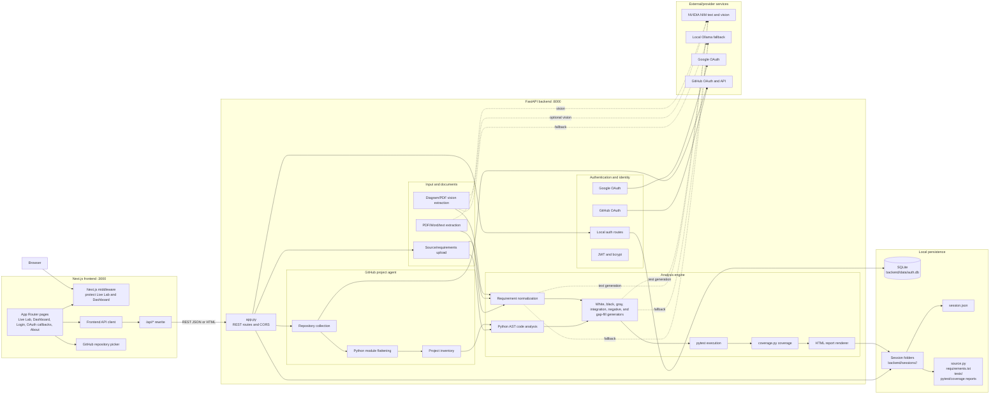

# AI-Assisted Intelligent Software Testing

An end-to-end testing application that accepts Python source code and natural-language requirements, analyzes both inputs, generates several kinds of pytest tests, executes the tests, measures line and branch coverage, closes detected coverage gaps, and produces an HTML report.

The application consists of a Next.js/React frontend and a FastAPI backend. It supports local Live Lab runs, document and diagram requirement extraction, local login and OAuth login, GitHub repository imports, and full GitHub repository analysis.

## Current capabilities

- Upload or edit a Python `.py` file.
- Enter requirements as text.
- Extract requirements from PDF, Word (`.doc`/`.docx`), text, Markdown, and common document formats.
- Extract requirements from PNG, JPEG, GIF, and WEBP diagrams or flowcharts.
- Analyze Python functions, parameters, return types, branches, and cyclomatic complexity through the Python AST.
- Convert requirements into `REQ-*` structured condition/result records.
- Generate:
  - white-box tests
  - black-box tests
  - gray-box tests
  - same-file integration tests
  - negative tests
  - gap-fill tests for uncovered lines or untested requirements
- Execute all generated tests with pytest.
- Run branch-aware coverage with `coverage.py`.
- Collect requirement traceability and failure diagnostics.
- Download a generated HTML test report.
- Store results in per-session folders and view them on the dashboard.
- Sign in with a local account, Google OAuth, or GitHub OAuth.
- Import a selected Python file and requirement file from a connected GitHub repository.
- Run a repository project agent that flattens a Python subset into one combined source file and runs the full testing workflow.

## Technology stack

| Area | Technology |
|---|---|
| Frontend | Next.js 13 App Router, React 18, TypeScript, Tailwind CSS |
| Frontend state/API | React hooks, browser local storage, Next.js rewrite proxy |
| Backend | Python, FastAPI, Uvicorn |
| Authentication | JWT bearer tokens, bcrypt, SQLite, Google OAuth, GitHub OAuth |
| Source analysis | Python `ast` |
| Requirement analysis | NVIDIA NIM, local Ollama, heuristic fallback |
| Visual extraction | NVIDIA vision model, uploaded image/PDF processing |
| Test generation | Python AST plus provider/heuristic case generation |
| Test execution | pytest and `pytest-json-report` |
| Coverage | `coverage.py` with branch tracking |
| Reporting | Jinja2 HTML templates |
| Session persistence | JSON manifests and files under `backend/sessions/` |
| User persistence | SQLite at `backend/data/auth.db` |

## System architecture



### Component responsibilities

| Component | Responsibility |
|---|---|
| `frontend/app/live-lab/page.tsx` | Main interactive pipeline UI, source/requirements editors, uploads, stage execution, GitHub picker |
| `frontend/app/dashboard/page.tsx` | Loads a session and displays metrics, source, functions, requirements, tests, coverage, and report download |
| `frontend/lib/api.ts` | Browser API wrappers, auth headers, session storage, and report download |
| `frontend/middleware.ts` | Redirects unauthenticated Live Lab and Dashboard requests to `/login` |
| `backend/app.py` | Public health/input/session/report routes and stage-specific REST endpoints |
| `backend/input_handler/` | Input validation, session creation, manifest locking, and source/requirements persistence |
| `backend/code_analysis/analyzer.py` | Extracts functions, branches, complexity, and source structure |
| `backend/requirement_analysis/` | Converts requirements to structured `REQ-*` records |
| `backend/test_generation/` | Generates white-box, black-box, gray-box, integration, negative, and gap-fill tests |
| `backend/execution/` | Runs pytest, builds diagnostics, measures branch coverage, and computes requirement coverage |
| `backend/reporting/` | Builds and serves the downloadable HTML report |
| `backend/auth/` | Local, Google, GitHub authentication and encrypted GitHub-token storage |
| `backend/agents/` | Repository collection, source flattening, and project-agent orchestration |

## End-to-end workflow

### 1. Authentication

1. The frontend checks whether protected routes have an authentication cookie.
2. The middleware redirects `/live-lab` and `/dashboard` to `/login` when no cookie exists.
3. A local account, Google callback, or GitHub callback creates a JWT.
4. The frontend stores the token/cookie and sends bearer authentication on protected API requests.
5. FastAPI validates the current user and restricts session access to the session owner.

### 2. Input and session creation

1. The user opens the Live Lab and selects a Python file or uses the sample.
2. The user enters requirements directly or uploads/extracts requirements.
3. The browser submits the source file and requirements to `POST /api/sessions`.
4. The backend validates that the source is a non-empty `.py` file and requirements are non-empty.
5. The source is limited to 350,000 characters and requirements to 50,000 characters.
6. The backend creates `backend/sessions/<session_id>/`, writes `source.py`, `requirements.txt`, `session.json`, and creates test/log directories.
7. The session ID is saved in browser local storage and returned to the dashboard.

### 3. Document or diagram extraction

For uploaded requirements:

- PDF, Word, text, and Markdown files pass through the document extractor.
- `.doc` is handled through available document conversion support.
- Diagram images pass through the vision extractor.
- Scanned or diagram-containing PDFs may be processed by visual extraction.
- Extracted text is inserted into the requirements editor before normal analysis.

### 4. Code analysis

`POST /api/sessions/{session_id}/code-analysis`:

1. Loads `source.py`.
2. Parses it with Python `ast`.
3. Finds top-level functions and supported function structure.
4. Records names, parameters, return annotations, source line ranges, branches, branch count, and cyclomatic complexity.
5. Saves `code_analysis` in `session.json`.

Class methods and complex package/import graphs are not treated as a complete cross-package runtime model.

### 5. Requirement analysis

`POST /api/sessions/{session_id}/requirement-analysis`:

1. Loads requirements text.
2. Sends a JSON-oriented prompt to NVIDIA NIM when configured.
3. Falls back to local Ollama when NVIDIA is unavailable or exhausted.
4. Uses a deterministic heuristic parser if no usable LLM response is available.
5. Normalizes records to `REQ-01`, `REQ-02`, and subsequent IDs.
6. Stores condition, expected result, and source excerpt for requirement traceability.

### 6. Test generation

The Live Lab runs each test generator in sequence:

| Stage | Endpoint | Purpose |
|---|---|---|
| White-box | `/white-box-tests` | Generates cases from AST functions and branches |
| Black-box | `/black-box-tests` | Generates behavior-oriented cases from structured requirements |
| Gray-box | `/gray-box-tests` | Combines requirement context with source/branch targets |
| Other tests | `/other-tests` | Generates same-file integration and negative tests |
| Gap-fill | `/gap-fill-tests` | Targets uncovered lines and requirements that are not tested |

Generated tests are written beneath `backend/sessions/<session_id>/tests/`. Unsafe or malformed generated inputs are validated before pytest code is emitted.

### 7. Test execution

`POST /api/sessions/{session_id}/execute-tests`:

1. Finds all test directories under the session.
2. Runs pytest recursively for that session.
3. Requests a pytest JSON report through `pytest-json-report`.
4. Captures pass/fail/error counts, durations, requirement IDs, error text, and test node IDs.
5. Builds failure diagnostics and requirement/requirement-coverage rows.
6. Saves `test_execution` and requirement coverage into `session.json`.

### 8. Coverage analysis

`POST /api/sessions/{session_id}/coverage`:

1. Removes previous coverage data.
2. Runs `coverage run --branch --source=source -m pytest`.
3. Exports `coverage.json`.
4. Calculates overall line and branch coverage.
5. Lists missing source lines.
6. Combines coverage data with analyzed function/branch metadata.
7. Saves `coverage`, `requirement_coverage`, and source-line status.

### 9. Gap-fill loop

After initial execution and coverage, the frontend checks whether any line or requirement remains uncovered.

If gaps exist:

1. The gap-fill generator creates additional test cases.
2. pytest executes the complete test suite again.
3. Coverage is measured again.
4. The latest session payload replaces the prior dashboard/report data.

The gap-fill pass is limited to detected source lines and untested requirements in the current session.

### 10. Reporting

The dashboard reads the latest session by URL or browser local storage.

`GET /api/sessions/{session_id}/report`:

1. Loads the latest session manifest and source.
2. Builds traceability, summary metrics, failures, source-line status, and coverage sections.
3. Returns a downloadable HTML document named `test-report-<session_id>.html`.

## GitHub workflows

### Import one file pair

1. The user connects GitHub through OAuth.
2. The frontend lists repositories available to the account.
3. The user browses repository contents.
4. The backend selects a `.py` source file and an optional requirement file.
5. GitHub file contents are decoded and sent to the Live Lab editor.
6. The standard local Live Lab workflow then creates and analyzes the session.

### Run the repository project agent

`POST /api/github/project-agent`:

1. Fetches repository metadata and the recursive Git tree.
2. Filters out irrelevant paths and unsupported/generated content.
3. Selects up to 80 Python files and up to 20 requirement/specification files.
4. Downloads files up to the configured blob limit.
5. Flattens selected Python modules into a combined Python source file.
6. Combines requirement documents or derives fallback requirements from discovered functions.
7. Creates a normal owned analysis session.
8. Runs code analysis, requirement analysis, white-box, black-box, gray-box, and other-test generation.
9. Executes tests and coverage.
10. Runs the gap-fill loop when coverage or requirement gaps remain.
11. Stores a `project/inventory.json` describing included/skipped modules and selected requirement files.
12. Saves GitHub project metadata and stage statuses in `github_agent`.

The project agent analyzes a bounded flattened subset, not a complete runtime import graph. Its cross-module behavior is therefore limited to what the flattening and test generators can represent.

## Session storage

Each session folder contains:

```text
backend/sessions/<session_id>/
  session.json
  source.py
  requirements.txt
  logs/
  regression/
  project/
  tests/
    white_box/
    black_box/
    gray_box/
    integration/
    negative/
    gap_fill/
  pytest_report.json
  coverage.json
  .coverage
```

The session manifest is updated atomically and guarded with a file lock. Session listing and retrieval are restricted to the authenticated owner for protected API routes.

## API overview

| Method | Route | Purpose |
|---|---|---|
| `GET` | `/health` and `/api/health` | Backend health |
| `GET` | `/api/status/llm` | Provider/configuration status |
| `GET` | `/api/examples` | Load sample source and requirements |
| `POST` | `/api/requirements/extract` | Extract requirements from a document |
| `POST` | `/api/requirements/extract-diagram` | Extract requirements from an image or visual PDF |
| `GET/POST` | `/api/sessions` | List/create owned sessions |
| `GET/PUT` | `/api/sessions/{id}` and `/source` | Read/update a session |
| `GET` | `/api/sessions/{id}/report` | Download HTML report |
| `POST` | `/api/sessions/{id}/code-analysis` | Analyze Python AST |
| `POST` | `/api/sessions/{id}/requirement-analysis` | Structure requirements |
| `POST` | `/api/sessions/{id}/{test-type}-tests` | Run a test-generation stage |
| `POST` | `/api/sessions/{id}/execute-tests` | Run pytest |
| `POST` | `/api/sessions/{id}/coverage` | Measure coverage |
| `POST` | `/api/sessions/{id}/gap-fill-tests` | Generate gap-fill tests |
| `POST/GET/DELETE` | `/api/github/*` | GitHub OAuth, repository browsing, import, and project agent |

Authentication routes include local registration/login, Google OAuth, current-user lookup, and logout behavior in `backend/auth/routes.py`.

## Running locally

### Prerequisites

- Python 3.11+ is recommended.
- Node.js and npm.
- An NVIDIA API key, or Ollama, for provider-assisted generation.
- Playwright browsers are only required for frontend E2E tests.

### Backend setup

From the repository root:

```powershell
py -m venv venv
.\venv\Scripts\Activate.ps1
python -m pip install -r backend\requirements.txt
```

Create `backend/.env` from the existing values or the README template below. The backend requires a persistent secret of at least 32 bytes:

```env
JWT_SECRET=<generated-random-secret>
NVIDIA_API_KEY=
NVIDIA_MODEL=nvidia/nemotron-3.5-lightning-30b-a3b
NVIDIA_VISION_MODEL=nvidia/nemotron-3.5-super-vl-120b-a12b
NVIDIA_BASE_URL=https://integrate.api.nvidia.com/v1
OLLAMA_BASE_URL=http://127.0.0.1:11434
OLLAMA_MODEL=llama3.2
FRONTEND_URL=http://localhost:3000
GOOGLE_CLIENT_ID=
GOOGLE_CLIENT_SECRET=
GOOGLE_REDIRECT_URI=http://localhost:3000/auth/google/callback
GITHUB_CLIENT_ID=
GITHUB_CLIENT_SECRET=
GITHUB_REDIRECT_URI=http://localhost:3000/auth/github/callback
```

Generate a stable JWT secret:

```powershell
python -c "import secrets; print(secrets.token_hex(32))"
```

Start the backend:

```powershell
cd backend
..\venv\Scripts\python.exe -m uvicorn app:app --reload --port 8000
```

The backend health endpoint should be available at `http://127.0.0.1:8000/health`.

### Frontend setup

In a second terminal:

```powershell
cd frontend
npm install
npm run dev
```

Open `http://localhost:3000/live-lab`.

The Next.js server proxies `/api/*` to `http://127.0.0.1:8000` by default. Set `API_PROXY_TARGET` to override it.

## Tests

Backend tests:

```powershell
cd backend
..\venv\Scripts\python.exe -m pytest -q
```

Frontend smoke tests:

```powershell
cd frontend
npm run test:e2e:smoke
```

## Known scope limits

- The system primarily supports Python source files and top-level functions.
- It does not execute the original repository import graph as-is.
- The GitHub project agent uses an 80-file/20-document bounded flattening step.
- Cross-package integration and class-method-oriented generation are limited.
- Provider-assisted results depend on API availability and local Ollama status.
- If no text provider is usable, requirement and test stages use heuristic/static fallbacks where implemented.
